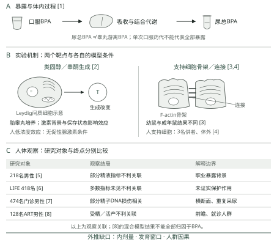

# 双酚A与男性生殖毒性

在[生殖毒理课](https://hanson2017ear.github.io/toxicology-course-notes/#unit-08)最后一道题里，研究者采集尿样测双酚 A（BPA），同时询问男性的性功能。若要进一步了解精子或生育力，就得找测过这些结果的研究。下面用八篇论文对照尿样、睾丸实验和人体观察各能回答什么。[原始研究索引](bpa-evidence.md)

## 尿里的数值该怎么读

14 名成年人单次口服带标记的 BPA 后，研究者在血液和尿液中追踪它的去向。BPA 很快发生结合代谢，尿中排出的主要是代谢物。尿样能提供近期接触的线索。至于睾丸里有多少未结合的 BPA，这项实验没有测量。[[1] 人体口服药代研究](https://pubmed.ncbi.nlm.nih.gov/26115537/)

## 睾丸里的两条实验线索

**睾酮生成。** 人和大鼠的胎睾丸都做了离体培养。试验中，人胎睾丸在最低名义处理浓度有反应，但只出现在未添加促性腺激素的培养条件下。那组组织保存较差，培养液中的实测浓度也高于名义浓度。要比较人和大鼠的敏感程度，得先看这些实验条件是否可比。[[2] 胎睾丸离体研究](https://journals.plos.org/plosone/article?id=10.1371/journal.pone.0117226)

**支持细胞与屏障。** 相邻的支持细胞之间有紧密连接，是血睾屏障的一部分。大鼠实验考察了屏障功能，幼龄鼠和成年鼠的结果有别。另一项研究培养了来自三名供者的人支持细胞。显微图中，BPA 处理后 F-actin 的排列和黏附蛋白的位置发生变化。要知道人体内的屏障通透性是否也改变，还需要直接测量。[[3] 大鼠屏障研究](https://pubmed.ncbi.nlm.nih.gov/19497385/) · [[4] 人支持细胞研究](https://pmc.ncbi.nlm.nih.gov/articles/PMC4017941/)

图 1　研究 [1] 追踪口服后的代谢，中间的组织示意图标出研究 [2–4] 关注的细胞，下方四项研究 [5–8] 比较男性的精液或生育结局。实验中观察到的变化能否解释人群结果，仍待验证。[打开原图](../docs/assets/bpa-evidence.svg)

## 比较四项人体研究

| 研究对象 | 观察到的结果 | 解读时的限制 |
| --- | --- | --- |
| [5] 218名工人，含职业暴露者 | 尿BPA较高与部分精液指标较差相关 | 样本中位数分组不等同于临床不育。 |
| [6] LIFE备孕人群，418名男性 | 多数指标未见不利关联，DNA碎片化有孤立反向关联 | 探索性分析未校正多重比较，单一结果不能说明保护作用。 |
| [7] 不孕症门诊，474名男性 | 重复尿样的BPA与部分彗星试验DNA损伤指标相关 | 横断面设计限制时间顺序，彗星试验与LIFE采用的检测不同。 |
| [8] 辅助生殖前瞻队列，128名男性 | 父亲孕前尿BPA与受精和活产结局呈不利关联 | 夫妻与治疗因素影响结局，摘要区间存在异常，仅作定性解读。 |

工人研究 [5] 和备孕人群研究 [6] 都检查了精液，但参与者的接触背景不同，比较时还要看尿样和精液各在什么时候采集。研究 [8] 随访到活产，结局又多了一层影响因素，包括伴侣的状况和辅助生殖治疗过程。[查看四项研究的取样与结局](bpa-evidence.md)

## 复习问题

1. 用单次尿BPA解释整个生精期的靶组织剂量，缺少哪些信息？
2. 人支持细胞的蛋白定位变化与大鼠血睾屏障功能变化，怎样设计研究才能比较？
3. 受精率、精子DNA指标和活产分别对应什么结局？解读关联时，各要考虑哪些因素？
